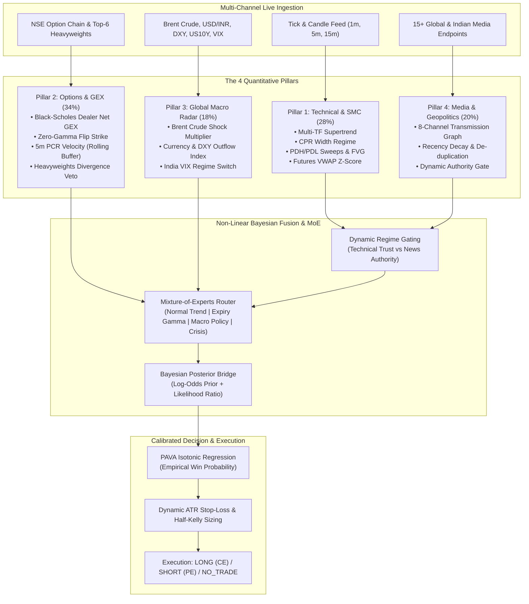
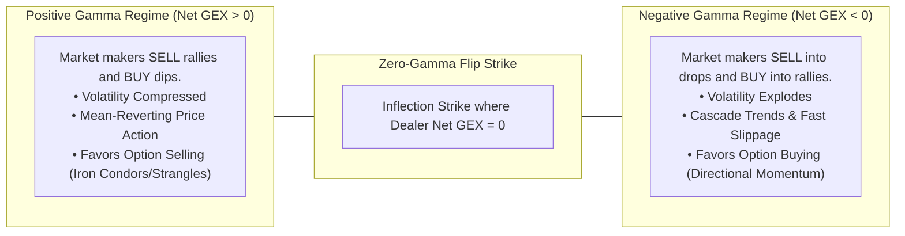

# NIFTY 50 Institutional Quant & 4-Pillar AI Terminal (v3.0)
## Complete Algorithmic & Quantitative Trading Logic Manual

---

## 1. Executive Summary & Design Philosophy

The **NIFTY 50 Institutional Quant Terminal** is an intraday quantitative decision engine built specifically for the **National Stock Exchange of India (NSE NIFTY 50 - `^NSEI`)**. 

Traditional retail indicators (RSI, standard MACD, moving average crossovers) fail consistently on index options because they are:
1. **Univariate & Lagging**: They observe only price or volume in isolation after institutional orders have executed.
2. **Blind to Microstructure & Dealer Positioning**: Market makers (dealers) writing index options do not trade on chart patterns; they dynamically hedge their delta exposure, creating predictable buying or selling flows (Gamma Exposure / GEX).
3. **Isolated from Macro & News Shocks**: Geopolitical tensions (e.g., Red Sea shipping, crude oil spikes), currency depreciation (USD/INR), and central bank rate shifts instantly shatter standard chart support and resistance levels.

To solve this, the engine deploys a **4-Pillar Calibrated AI Ensemble** augmented with a **Non-Linear Regime-Gated Mixture-of-Experts (MoE)** and **Bayesian News Updating**.



---

## 2. Pillar 1: Technical, Smart Money Concepts (SMC) & VWAP (28% Weight)

Pillar 1 tracks price delivery, institutional liquidity resting points, and volume-weighted anchor levels.

### 2.1 Multi-Timeframe Supertrend Consensus
Rather than relying on a single timeframe, the engine calculates the Average True Range (ATR) Supertrend across three non-correlated timeframes:
- **1-Minute (`1m`)**: Micro-execution entry timing.
- **5-Minute (`5m`)**: Intraday structural trend.
- **15-Minute (`15m`)**: Institutional anchor trend.

```
Supertrend Formula:
Basic Upper Band = (High + Low) / 2 + Multiplier × ATR(Period)
Basic Lower Band = (High + Low) / 2 - Multiplier × ATR(Period)
```
- **Consensus Score ($S_{trend}$)**:
  - If all 3 timeframes align Bullish: $+1.0$
  - If 2 timeframes align Bullish: $+0.50$
  - If all 3 timeframes align Bearish: $-1.0$
  - If 2 timeframes align Bearish: $-0.50$
  - Conflicting timeframes trigger a neutral state ($0.0$).

### 2.2 Central Pivot Range (CPR) Width Analysis
The Central Pivot Range acts as institutional mean-reversion gravity or breakout fuel:
$$\text{Pivot} = \frac{\text{High} + \text{Low} + \text{Close}}{3}$$
$$\text{Bottom Central (BC)} = \frac{\text{High} + \text{Low}}{2}$$
$$\text{Top Central (TC)} = (\text{Pivot} - \text{BC}) + \text{Pivot}$$
$$\text{CPR Width} = \frac{|\text{TC} - \text{BC}|}{\text{Pivot}} \times 100\%$$

* **Tight CPR ($< 0.18\%$)**: Indicates previous session consolidation. Signals high probability of an **Aggressive Directional Breakout Trend Day**.
* **Wide CPR ($> 0.38\%$)**: Indicates previous session expansion. Signals an **Options Seller (Theta Decay) Range-Bound Day** with strong support/resistance at TC and BC.

### 2.3 Smart Money Concepts (SMC): Sweeps & Fair Value Gaps (FVG)
* **Liquidity Sweeps (PDH / PDL)**: Retail stop-losses cluster directly above Previous Day High (PDH) and below Previous Day Low (PDL). When spot crosses PDH/PDL by $< 0.15\%$ and immediately closes back inside the previous range within 2 candles, the engine classifies this as a **Turtle Soup Institutional Liquidity Sweep**, triggering a high-conviction mean-reversion signal.
* **3-Candle Fair Value Gap (FVG)**:
  - **Bullish FVG**: $\text{Low}(C_3) > \text{High}(C_1)$ (Imbalance gap where sellers were absent).
  - **Bearish FVG**: $\text{High}(C_3) < \text{Low}(C_1)$ (Imbalance gap where buyers were absent).

### 2.4 Volume-Weighted Average Price (VWAP) Z-Score
Measures standard deviation stretch from the true institutional volume anchor:
$$Z_{vwap} = \frac{\text{Spot} - \text{VWAP}}{\sigma_{vwap}}$$
- When $Z_{vwap} > +2.5$: Overextended exhaustion zone (risk of mean-reversion drop).
- When $Z_{vwap} < -2.5$: Undervalued compression zone (risk of short-covering squeeze).

---

## 3. Pillar 2: Options Microstructure, Gamma Exposure & Heavyweights (34% Weight)

Options microstructure is the engine's highest-weighted pillar (34%) because market maker hedging mechanics drive short-term intraday index price discovery.

### 3.1 Analytical Black-Scholes Dealer Net Gamma Exposure (Net GEX)
Market makers who write options must remain delta-neutral. If they are net short options, their hedging forces them to trade in the direction of the market (amplifying volatility). If net long, they trade against the market (dampening volatility).

For each active strike $K$ across Call and Put option chains:
$$d_1 = \frac{\ln(S/K) + (r + \frac{\sigma^2}{2})T}{\sigma \sqrt{T}}$$
$$\Gamma = \frac{N'(d_1)}{S \sigma \sqrt{T}} = \frac{\frac{1}{\sqrt{2\pi}} e^{-\frac{d_1^2}{2}}}{S \sigma \sqrt{T}}$$
$$\text{Strike GEX}_{\text{Call}} = + (\text{Spot} \times \Gamma \times \text{Open Interest}_{\text{Call}} \times 50)$$
$$\text{Strike GEX}_{\text{Put}} = - (\text{Spot} \times \Gamma \times \text{Open Interest}_{\text{Put}} \times 50)$$
$$\text{Net GEX (₹ Cr)} = \frac{\sum \text{Strike GEX}_{\text{Call}} + \sum \text{Strike GEX}_{\text{Put}}}{10^7}$$



### 3.2 15-Minute Rolling Put-Call Ratio (PCR) Velocity
Static PCR is an unreliable lagging number. The engine maintains a rolling ring buffer of 1-minute snapshots to calculate **5-minute PCR Velocity**:
$$\Delta \text{PCR}_{5m} = \text{PCR}_t - \text{PCR}_{t-5min}$$
- **$\Delta \text{PCR} > +0.08$**: Fast institutional Put writing $\rightarrow$ Bullish floor established.
- **$\Delta \text{PCR} < -0.08$**: Fast institutional Call writing / Put unwinding $\rightarrow$ Bearish ceiling established.

### 3.3 Trapped Option Writer Panic Detection
When spot price crosses the largest Call Open Interest strike (Call Wall) with rising volume, Call writers are forced into panic short-covering (buying NIFTY futures or underlying stocks to cover delta), creating an explosive **Gamma Squeeze**.

### 3.4 Top-6 NIFTY Heavyweights Basket & Divergence Veto
The top 6 stocks on the National Stock Exchange represent **~42% of NIFTY 50's total index weighting**:
1. **HDFC Bank (`HDFCBANK`)** — 27.5% sector basket weight
2. **Reliance Industries (`RELIANCE`)** — 23.5%
3. **ICICI Bank (`ICICIBANK`)** — 19.5%
4. **Infosys (`INFY`)** — 13.0%
5. **Larsen & Toubro (`LT`)** — 9.5%
6. **Tata Consultancy Services (`TCS`)** — 7.0%

$$\Delta_{\text{heavyweights}} = \sum_{i=1}^6 W_i \times \text{ChangePct}_i$$

> [!CAUTION]
> **Heavyweight Divergence Veto Rule**:
> - If NIFTY technicals signal **LONG**, but $\Delta_{\text{heavyweights}} < -0.65\%$ (Heavyweights are distributing), the engine triggers an automatic **VETO**, locking the stance to `NO_TRADE_CASH`.
> - If NIFTY technicals signal **SHORT**, but $\Delta_{\text{heavyweights}} > +0.65\%$ (Heavyweights are being accumulated), the short trade is vetoed.

---

## 4. Pillar 3: Cross-Asset Macro & Global Radar (18% Weight)

India imports over 85% of its crude oil requirements and relies heavily on Foreign Institutional Investor (FII) capital inflows. Pillar 3 monitors the global transmission conduits:

| Macro Variable | Transmission Channel to NSE NIFTY 50 | Warning Threshold |
| :--- | :--- | :--- |
| **Brent Crude Oil (`$/bbl`)** | Direct pressure on India's Current Account Deficit (CAD), fiscal deficit, and corporate operating margins (paints, tyres, aviation, auto). | Spikes $> +2.5\%$ in 24h or level $> \$85/\text{bbl}$ |
| **USD/INR & US Dollar Index (DXY)** | A rising DXY or depreciating INR forces foreign portfolio investors (FPI/FII) to sell Indian equities to hedge currency depreciation risk. | DXY $> 104.5$ or USD/INR breaking all-time highs |
| **US 10Y Treasury Yield** | Global risk-free benchmark rate. When US yields rise, emerging market equities experience institutional outflows. | Yield $> 4.35\%$ |
| **GIFT Nifty Spread** | Spread between GIFT Nifty (Singapore/NSE IX) futures and NSE cash close, setting the baseline opening gap. | Spread $> \pm 45$ points |
| **India VIX Level & Velocity** | Market fear gauge. Governs ATR stop-loss multipliers and option buying vs writing regimes. | VIX Velocity $\Delta VIX > +8\%$ intraday |

---

## 5. Pillar 4: 15-Endpoint Media Intelligence & Bayesian Wire (20% Weight)

Pillar 4 scans 15+ domestic and international news endpoints (Economic Times, LiveMint, Moneycontrol, Business Standard, Google News Financial, CNBC World).

### 5.1 The 8-Channel Transmission Graph
Every scanned headline is mapped through an 8-channel domain lexicon:
1. **`geopolitics_conflict`**: Military actions, missile strikes, Red Sea/Strait of Hormuz disruptions, sanctions.
2. **`energy_crude_supply`**: OPEC+ decisions, pipeline outages, oil refinery strikes.
3. **`monetary_policy_rates`**: RBI MPC repo rate decisions, US Fed FOMC interest rate cuts/hikes.
4. **`fiscal_regulation_sebi`**: Union Budget announcements, capital gains tax changes, SEBI F&O regulatory curbs.
5. **`fii_dii_flows`**: FII block deals, mutual fund cash reserves, rupee bond market flows.
6. **`banking_financials`**: HDFC Bank, ICICI Bank, SBI NPA/credit growth reports.
7. **`it_tech_nasdaq`**: TCS, Infosys earnings, US tech earnings correlation.
8. **`macro_economic_growth`**: India GDP growth, CPI inflation, trade balance.

### 5.2 Non-Linear Processing (Beyond Simple Linear Weights)
News does not affect financial markets as an isolated linear addition. The terminal implements three non-linear mechanisms:

#### Mechanism 1: Dynamic Regime Gating
$$\text{Technical Trust Gate} = \max\left(0.15, \, 1.0 - 0.85 \times \text{News Shock Intensity}\right)$$
$$\text{News Authority Gate} = \min\left(1.85, \, 1.0 + 0.90 \times \text{News Shock Intensity}\right)$$
- During calm markets ($\text{Intensity} \approx 0$): Technical and options signals receive full 100% weighting.
- When sudden war or policy shocks break ($\text{Intensity} \rightarrow 1.0$): Lagging chart technicals are gated down to 15%, while live news transmission and option market maker gamma take precedence.

#### Mechanism 2: Mixture-of-Experts (MoE) Routing
Based on current volatility, calendar day, and news velocity, routing weights dynamically blend four specialized expert models:
1. **`NORMAL_TREND_EXPERT`**: Standard intraday trading sessions.
2. **`EXPIRY_GAMMA_EXPERT`**: Active on Thursday weekly expiry days when gamma decay accelerates.
3. **`MACRO_POLICY_EXPERT`**: Active during RBI MPC, Fed rate announcements, or Union Budget sessions.
4. **`GEOPOLITICAL_CRISIS_EXPERT`**: Active during military conflicts or oil supply shocks.

#### Mechanism 3: Bayesian Prior $\rightarrow$ Posterior Bridge
$$\text{Log-Odds}_{\text{Prior}} = \ln\left(\frac{P_{\text{technical/options}}}{1 - P_{\text{technical/options}}}\right)$$
$$\text{Log-Odds}_{\text{Posterior}} = \text{Log-Odds}_{\text{Prior}} + \lambda_{\text{news}} \times \text{News Likelihood Log-Ratio}$$
$$P_{\text{Posterior}} = \frac{1}{1 + e^{-\text{Log-Odds}_{\text{Posterior}}}}$$

---

## 6. Machine Learning Ensemble & PAVA Isotonic Calibration

To prevent overfitting, the system combines **L2-Regularized Logistic Regression** with a **Gradient Residual Stump Ensemble** trained via Marcos López de Prado's **Triple-Barrier Method**:
- **Upper Profit Barrier ($TP$)**: $+1.75 \times \text{ATR}_{5m}$
- **Lower Stop-Loss Barrier ($SL$)**: $-1.15 \times \text{ATR}_{5m}$
- **Vertical Time Horizon**: 60 minutes maximum holding period.

### PAVA Isotonic Calibration
Raw classifier probabilities are notoriously uncalibrated (a model predicting 80% win rate might only win 55% in live execution). The engine passes all raw probability scores through the **Pool-Adjacent-Violators Algorithm (PAVA)** to generate strictly monotonic, empirically calibrated probabilities:

```
[Raw Model Score] ──► [Isotonic Regression Knots] ──► [True Historical Win Probability]
```

---

## 7. Execution Engine, Risk Management & Kelly Sizing

When a directional trade setup is confirmed ($P_{\text{win}} \ge 64.0\%$), the execution engine determines the exact parameters:

### 7.1 Volatility-Scaled ATR Stop-Loss & Targets
$$\text{VIX Scale} = \text{clip}\left(\frac{\text{India VIX}}{14.0} \times \text{News Volatility Multiplier}, \, 0.85, \, 1.85\right)$$
$$\text{Effective ATR} = \text{ATR}_{5m} \times \text{VIX Scale}$$
$$\text{Stop Loss (SL)} = \text{Spot} \pm (1.15 \times \text{Effective ATR}) \quad [\text{Widened to } 1.45 \text{ during crisis}]$$
$$\text{Target 1 (TP1)} = \text{Spot} \mp (1.75 \times \text{Effective ATR}) \quad [\text{Minimum } 1:1.5 \text{ Risk:Reward}]$$
$$\text{Target 2 (TP2)} = \text{Spot} \mp (2.90 \times \text{Effective ATR}) \quad [\text{Trend Runner}]$$

### 7.2 Optimal Option Contract Selection
- **Bullish Consensus**: Chooses the nearest **In-The-Money (ITM) Call (CE)** strike:
  $$\text{Strike}_{\text{Call}} = \text{RoundTo50}(\text{Spot}) - 50 \quad (\text{Delta} \approx 0.54 - 0.58)$$
- **Bearish Consensus**: Chooses the nearest **In-The-Money (ITM) Put (PE)** strike:
  $$\text{Strike}_{\text{Put}} = \text{RoundTo50}(\text{Spot}) + 50 \quad (\text{Delta} \approx -0.54 - -0.58)$$

### 7.3 Half-Kelly Capital Sizing
To prevent catastrophic ruin while maximizing exponential geometric growth:
$$\text{Full Kelly Fraction } f^* = \frac{p \cdot b - (1 - p)}{b}$$
$$\text{Recommended Allocation} = \text{Half-Kelly} = 0.5 \times f^* \quad (\text{Capped at maximum } 12.5\% \text{ of trade capital})$$
*(where $p = \text{Win Probability}$, $b = \text{Risk-to-Reward Ratio}$).*

---

## 8. Summary Comparison for Traders

| Feature | Retail Technical Approach | NIFTY 50 4-Pillar AI Terminal |
| :--- | :--- | :--- |
| **Market Data** | Price and volume of spot chart only | Spot, 1m/5m/15m Supertrends, Options chain, Top-6 Heavyweights, Macro, Global News |
| **Options Analysis** | Static PCR numbers | True analytical Black-Scholes Net GEX, Zero-Gamma strike, 5m PCR Velocity, Trapped Writer panic |
| **Stock Weighting** | Treats all stocks equally | Explicit Top-6 Heavyweights basket (~42% NIFTY weight) with automated Divergence Veto |
| **Macro Tracking** | Ignored until gap-down happens | Real-time monitoring of Brent crude, USD/INR, DXY, and 10Y Treasury yields |
| **News Handling** | Subjective, reactive manual reading | 15-endpoint concurrent NLP parser mapped across an 8-channel economic transmission graph |
| **Risk Model** | Fixed point stop-loss (e.g., 20 pts) | Dynamic VIX and ATR volatility-scaled stops with Half-Kelly position sizing |

